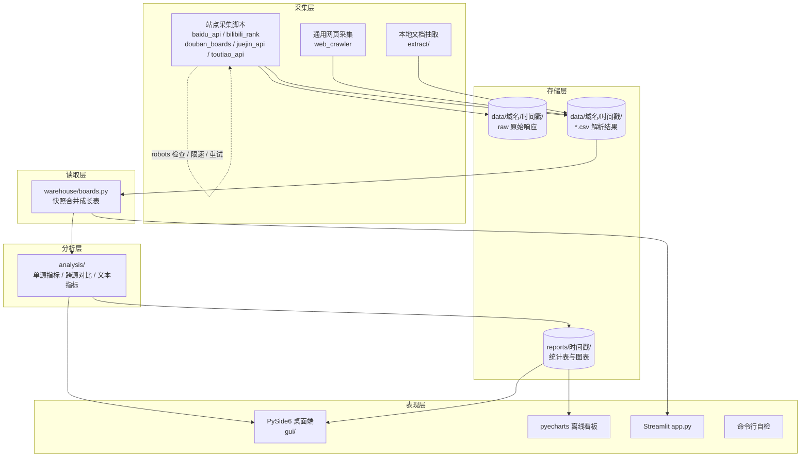
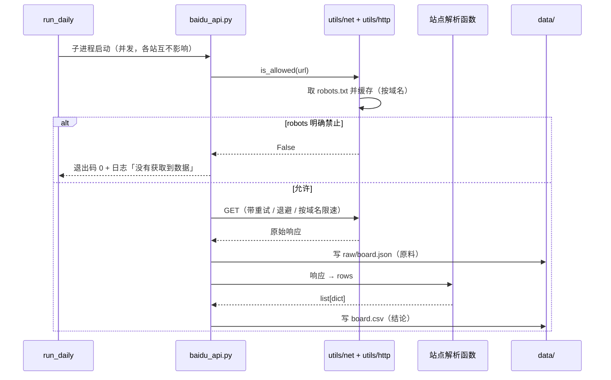
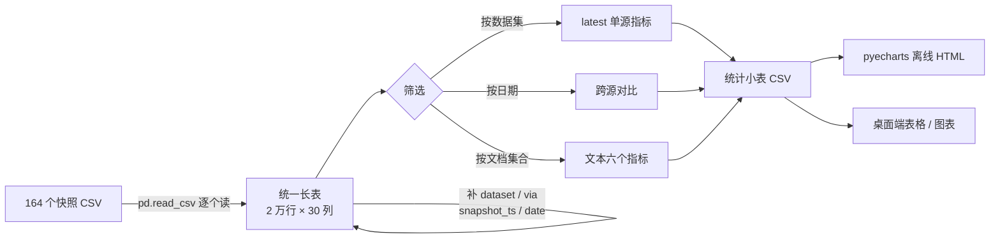

# 系统架构

本文说明「榜单采集与分析工具」的整体结构、各层职责与数据流。
设计上有两个贯穿始终的原则，先讲清楚，后面的具体设计才好理解：

**原则一：原料与结论分离。** 采集层把站点的**原始响应**（JSON / HTML）和**解析结果**（CSV）
都存下来，且按「域名 / 时间戳」分快照存放。这样解析规则改了就离线重跑，
不用重新抓一遍；数据错了也能回溯到当时的原始响应。

**原则二：口径集中。** 「最新快照怎么算」「名次怎么比」「URL 怎么规范化」
这类会直接决定统计结果对错的规则，各自只有一处实现
（`analysis/common.py`、`utils/schema.py`、`warehouse/boards.py`），
其它地方一律调用，不重复写。原因很直白：同一份长表里一个数据集有十几个快照，
`latest()` 少筛一次，同一部电影就被数 18 次 —— 表格照样生成，数字全错，而且不报错。

## 1. 分层视图

调用方向是单向的：采集层从不读分析层的代码，分析层从不发网络请求。
`analysis/` 下的模块全部是「输入 DataFrame → 输出 DataFrame」的纯函数，
所以可以脱网、用造出来的数据测试（见 `tests/test_analysis.py`）。

## 2. 目录职责

| 目录 | 职责 | 不该做的事 |
|---|---|---|
| `parsers/` | HTML → `list[dict]`，纯函数 | 不联网、不写文件、不知道快照是谁 |
| `extract/` | 本地文档 → 「一条文本一行」的表 | 不联网、不画图 |
| `utils/` | 横切能力：HTTP 韧性、robots、路径、日志、schema | 不含业务规则 |
| `warehouse/` | 快照 → 统一长表，补派生列 | 不统计、不画图 |
| `analysis/` | 长表 → 统计小表 | 不联网、不读原始文件 |
| `charts/` | 统计表 → pyecharts 图 | 不取数据 |
| `gui/` | 界面与交互 | 不实现业务逻辑，只编排 |
| `tests/` | 单元测试 | 不联网、不碰真实 `data/` |

## 3. 数据流

### 3.1 一次站点采集

原料和结论分开存的价值在于：站点改版导致解析失败时，
`raw/` 里的原始响应还在，改好解析规则就能重跑（`python parsers/xxx.py local.html` 即可自检）。

### 3.2 从快照到看板

派生列的作用是把「文件路径里的信息」提升成「可以被筛的列」：
`dataset` 来自登记表 `SOURCES`，`via` 记录数据经由哪个站点拿的
（B 站有 `api.bilibili.com` 与 `tophub.today` 两条路），
`snapshot_ts` / `date` 来自快照目录名。

## 4. 关键设计决策

### 4.1 为什么快照不复用、不覆盖

每次采集都新建一个 `域名/时间戳/` 目录，从不原地更新。
代价是磁盘增长（当前 164 个快照约 49 MB），换来的是：

- 榜单类数据**本身就是时间序列**，「某条目在第几天的第几名」是最有价值的信息，
  覆盖掉就没了；
- 抓取失败时会留下空目录而不是删掉旧数据，`warehouse.audit()` 能据此发现「今天没采到」。

### 4.2 为什么用统一长表而不是宽表

各站点字段差异很大（豆瓣有评分和票数，B 站有播放量和 UP 主，掘金有作者）。
统一成宽表就得为所有站点预留所有列，绝大部分是空的。
长表 + 「核心列 + 站点特有列」的方案（`utils/schema.py`）让
单源分析能用到全部字段，跨源分析只用核心列（`rank` / `title` / `source` / `date`）。

### 4.3 为什么跨源只比名次，不比热度值

百度热搜的「热度」、B 站榜单的「播放量」、豆瓣的「评分」是三套完全不同的度量，
直接比较没有意义，甚至会被误读成「百度热度比豆瓣评分高 100 倍」。
`analysis/cross.py` 因此只使用 `rank`：名次在所有榜单里语义一致，天然可比。

### 4.4 为什么网络韧性放在 adapter 层

`utils/http.py` 把重试与限速挂在 requests 的 `HTTPAdapter` 上，而不是
在每个采集脚本里写循环。`send()` 是所有请求的唯一出口，因此：

- 跟随重定向也受同一套限速约束（脚本里写循环做不到这一点）；
- 现有采集脚本**一行都不用改**就获得了韧性；
- 限速策略改一处，五个站点全生效。

### 4.5 为什么要对 robots 里的 `?` 规则特殊处理

Python 标准库的 `RobotFileParser` 在匹配前会**丢掉 URL 的 query 部分**，
于是 `Disallow: /*?*` 这类规则全部失效（实测 zol 的三条此类规则都被判成「允许」）。
`utils/net.py` 的对策是：只要 robots 原文里存在带 `?` 的规则，
就保守拒绝所有带查询参数的 URL。这是技术上能做到的、
最接近站方真实意图的判定，也是 `tests/test_net.py` 里专门守着的行为。

## 5. 打包与运行形态

同一套代码有三种运行形态，由 `utils/paths.py` 的 `is_frozen()` 统一判定：

| 形态 | 入口 | 子进程怎么起 |
|---|---|---|
| 开发 | `python main.py` | `python -m 模块名` |
| PyInstaller | `CrawlerStudio.exe`（`CrawlerStudio.spec`） | `exe --task 模块名` |
| Nuitka | 编译出的 `CrawlerStudio.exe` | 同上 |

`is_frozen()` 依次判断 `sys.frozen`（PyInstaller）、`__compiled__`（Nuitka）、
以及「`sys.executable` 的名字不像 python」这条兜底 —— 因为 Nuitka 下
`sys.executable` 会报成 `dist/` 里一个**实际不存在**的 `python.exe`，
直接拿它起子进程会失败，界面表现为「启动失败」。

## 6. 质量保障

| 手段 | 位置 | 状态 |
|---|---|---|
| 单元测试 | `tests/` | 245 个用例，核心层覆盖率 77%–100%，合计 48% |
| 静态检查 | `pyproject.toml` → ruff | 0 告警 |
| 类型检查 | `pyproject.toml` → mypy | 50 个文件零告警 |
| 提交钩子 | `.pre-commit-config.yaml` | ruff + 基础卫生检查 |
| 自检命令 | `python -m utils.net` / `warehouse.boards` / `analysis.common` | 人工可跑 |

覆盖率的分布是刻意的：数据层（`parsers` 100%、`schema` 100%、`net` 96%、
`boards` 88%、`http` 90%）逼近满分，而界面层（`gui/`、`main.py`）不计入 ——
Qt 界面的价值在于交互，单元测试的投入产出比很低，靠人工走查。
